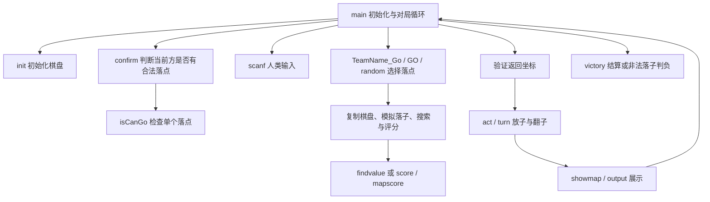

# 黑白棋旧项目状态整理

检查日期：2026-09-29

原项目：`Black and White Chess`（旧 C/C++ 项目，未随本仓库发布）

本报告及检查产物：当前项目；审计原始产物仅保留在作者本地

## 1. 总体判断

这是一个以黑白棋课程作业接口为核心、逐步扩展成多种 AI 实验的 C/C++ 控制台项目集合。基础对局已经做成；高级 AI、统计实验和棋盘尺寸调整保留了大量中间版本，尚未形成一个统一、可靠的最终版本。

最值得保留的是三部分：基础规则、已经能够完整对局的双人/简单人机程序，以及高级 AI 的设计思路。现在最影响判断的不是目录数量，而是多个版本各自复制了一套规则和搜索代码，修改没有同步，部分缺陷也随复制传播。

本次没有修改、迁移或删除原项目文件，没有重新生成原目录中的 EXE。编译、测试和报告全部保存在当前工作目录。

### 验证结论

- 目录中有 **27 个 vcxproj、28 个 cpp**；解决方案实际列入 **25 个子项目**。`ConsoleApplication2/3` 不在当前解决方案内。
- 所有 vcxproj 均只编译自己的一个 cpp，没有 ProjectReference，也没有项目自己的公共头文件或库。它们是独立程序/实验草稿，不是互相链接的模块。
- 使用本机 **Visual Studio 2022 MSVC 14.42、x86、/Od** 逐项目直接编译原始源码：**16 个成功，11 个失败**。这不是使用旧 v110 工具集重建解决方案，不能把工具链兼容错误等同于当年的错误。
- 主项目的非 const 规则实现，通过 **100 局随机完整对局、9,598 次落子、984,300 次合法性比较**的独立规则对照；期间还核对了翻子、无棋可下和胜负结果。
- `human va human` 与 `ConsoleApplication1` 各通过一局 **96 步完整对局**。前者最终黑 59、白 41；后者黑 41、白 59，与独立计算一致。
- 部分高级 AI 仍存在明确错误；`superAI` 本次运行发生访问冲突，`test/test2/test3` 复现非法落子判负。能编译不代表 AI 正确。

上述规则验证只覆盖所测试的实现与合法局面，不代表所有复制版本都正确，也不覆盖异常用户输入。

## 2. 实际架构关系

### 工程层面

```text
Black and White Chess.sln（VS2012，Debug/Release，Win32，v110）
 ├─ 基础/交互程序：human va human、ConsoleApplication1
 ├─ AI 对战和统计：Black and White Chess、game、superAI、superAI2.0 等
 ├─ 搜索实验：random、test/test2/test3/test4、new、brandnew
 ├─ 棋盘尺寸实验：cpu vs human、test5、ConsoleApplication7
 └─ 草稿/辅助程序：basic、save、read、copy、ConsoleApplication4/5/6

磁盘上另有 ConsoleApplication2/3，未加入当前 sln。
各子项目独立编译，主要通过复制代码产生联系。
```

解决方案中的 `game` 对应磁盘目录 `black and white chess2`，所以看到 `game.exe` 时不能只按目录名寻找源码。当前启动项目无法仅从 sln 确认；这里说的“主项目”是指名称为 `Black and White Chess` 的项目。

### 一个程序内部



常见棋盘为 `int map[12][12]`，其中 `1..10` 是有效棋盘，最外圈是值为 `BLANK=2` 的哨兵。`BLACK=0`、`WHITE=1`。合法性和翻子扫描依赖这圈哨兵终止，因此“只复制中间棋盘”会破坏规则代码依赖的条件。

主要 AI 分为几类：

| 类别 | 实现方式 | 代表版本 |
|---|---|---|
| 贪心 | 选择当步翻子最多的位置 | `GO`、`ConsoleApplication1::TeamName_Go` |
| 随机 | 枚举合法落点后随机选取 | `random()`、部分 `TeamName_Go2` |
| 枚举统计 | 手动展开落子树，统计后续棋子数量或终局胜率 | `random`、`test` 系列 |
| 随机模拟 | 随机下完整盘，按首步汇总胜率 | `new/brandnew::Go1/Go2` |
| 手动搜索与剪枝尝试 | 用 `goto`、数组维护搜索深度、回溯棋盘、分值和剪枝状态 | 主项目黑方、`superAI` 系列 |
| 递归 Minimax | `max/min` 交替调用，使用 `score/mapscore` 评价 | 主项目白方、`test7::TeamName_Go0` |

主项目实际是 **黑方 `TeamName_Go1` 对白方 `TeamName_Go2`** 的自动比赛，没有模式选择菜单。两个 AI 甚至分别使用两套落子模拟和评分实现。`const map` 与非 `const map` 的两版 `isCanGo` 在 C++ 中构成重载，本身不是重复定义编译错误，但增加了理解和维护成本。

手动搜索中的 `savemap` 是内存中的搜索回溯快照，注释“存档/读档”不代表游戏保存和载入功能。

## 3. 每个目录的用途与当前状态

“通过/失败”指本次直接编译原始 cpp 的结果。“历史成功”只说明保存的旧日志曾经生成 EXE。

| 目录 / 项目 | 实际用途 | 本次构建 | 状态判断 |
|---|---|---|---|
| `Black and White Chess` | 两种高级 AI 对战 | 通过 | 集成实验入口；搜索、评分和棋盘复制有明确缺陷 |
| `human va human` | 两人输入坐标对战 | 通过 | 完整对局验证通过；保留了未使用的 AI 函数 |
| `ConsoleApplication1` | 人类执黑对贪心 AI | 通过 | 完整对局验证通过，适合作为简单人机基线 |
| `ConsoleApplication2` | 另一版合法性判断，贪心自对弈 | 通过 | 不在 sln；本次两步后进入非法落子判负分支 |
| `ConsoleApplication3` | 同上 | 通过 | 与 `ConsoleApplication2` 的 cpp 字节完全一致，可视为重复副本 |
| `black and white chess2` / `game` | AI 对随机方，100 局统计 | 通过 | 逐局有初始化，但最高分选择、随机方与结果打印有问题 |
| `black and white chess3` | 搜索 AI 对贪心 AI | 失败 | 缺少 `findvalue`、`clean`，不是完整可编译版本 |
| `superAI` | 早期手动搜索/剪枝 AI 对贪心 AI | 通过 | 本次运行访问冲突；另有 `==` 误写为赋值意图的缺陷 |
| `superAI2.0` | 抢角、按自由度切换深度、100 局评估 | 通过 | 百局不重置棋盘，报告胜率不可信；保留选点缺陷 |
| `random` | 枚举参数 x/y，逐组合进行百局测试 | 通过 | 不是单纯随机棋手；统计计数跨 y 参数累积，搜索有旧缺陷 |
| `test` | 中盘 5 层枚举、少于 10 空格时终局枚举 | 通过 | 本次黑方第一步就非法，直接判白胜 |
| `test2` | 同类搜索的修改版本 | 通过 | 本次 13 步后白方非法判负；不能视为完整对局 |
| `test3` | 搜索阈值改为 30，另一种随机对手 | 通过 | 本次两步后黑方非法判负；深度设置也可能导致搜索量很大 |
| `test4` | 固定首步、7 层枚举、少于 5 空格枚举到终局 | 通过 | 8 秒观察窗内走到约 90 步，未验证结束 |
| `test5` | 用额外格子填 `3` 模拟 8×8；较深搜索的人机版 | 通过 | 玩家实际执白；界面仍称玩家执黑；边界值与规则判断不一致 |
| `test7` | AI 对战、符号棋盘、合法落点提示、计时 | 失败 | 旧日志成功；现代 CRT 不再声明 `gets`；还继承复制/搜索问题 |
| `cpu vs human` | 正式缩小数组的 8×8 人机尝试 | 失败 | 内部改成 `[10][10]`，main 仍是 `[12][12]`；评分循环也有错误 |
| `ConsoleApplication7` | 填白棋缩小活动区域的对战统计 | 通过 | 初始额外 36 格为白棋；这些仍参与计分与翻子，不是真正 8×8 |
| `new` | 两种随机整局模拟 AI 加对战框架 | 失败 | main 调用未定义 `TeamName_Go1`；已定义的是 `Go1/Go2` |
| `brandnew` | `Go1/Go2` 随机整局模拟草稿 | 失败 | 没有 main；选择胜率用整数保存小数，不能正确选最大值 |
| `basic` | 初始化、合法性判断两个基础函数 | 失败 | 作为 EXE 缺 main；有参考价值，但没有被其他项目引用 |
| `save` | 多份 `TeamName_Go1` 代码草稿 | 失败 | 重复函数、缺常量和依赖；不是保存游戏的模块 |
| `read` | 从 `D:\data.txt` 读入实验结果并排序 | 失败 | 文件尾残缺；另有读取、排序和 printf 参数错误；不参与游戏 |
| `copy` | 读取 data.txt，去掉百分号写入 data2.txt | 通过 | 独立数据清洗小工具；重复 fopen、EOF 处理不当；未运行 |
| `ConsoleApplication4` | 拆出来的对局控制部分 | 失败 | 缺 init、isCanGo、TeamName_Go，未与 basic 等链接 |
| `ConsoleApplication5` | 拼接多段搜索和对局代码 | 失败 | showmap、confirm、act、switch1、victory 等重复定义 |
| `ConsoleApplication6` | 从函数体截取的代码片段 | 失败 | 第一行就是 `{`，缺少函数声明及外围上下文 |

此外，`Black and White Chess\源.cpp` **没有加入主项目的编译清单**，属于额外算法草稿。修改它不会改变主项目 EXE，这是一个很容易误判“改了代码没有效果”的地方。

## 4. 功能完成度

| 功能 | 状态 | 说明 |
|---|---|---|
| 10×10 初始化、合法落子、八方向翻子 | 已实现，核心版本通过对照验证 | 需要保证坐标有效、哨兵完整 |
| 无棋可下跳过、双方无棋可下结束、胜负结算 | 对局外层已实现 | AI 搜索内部对跳过和终局的处理并不统一 |
| 本地双人对战 | 已实现 | `human va human` 可作为起点 |
| 简单人机对战 | 已实现 | `ConsoleApplication1` 可作为起点 |
| AI 自动对战 | 框架已实现 | 具体高级 AI 的落子正确性和稳定性未过关 |
| 位置权重、自由度评价 | 已接入 | 不代表权重经过有效评估 |
| 稳定子评价 | 写了，但存在严重错误 | 不区分所属方；主项目分差计算中会抵消 |
| 空区连通性/奇偶性评价 | 有草稿，主要版本未启用 | 主项目直接返回 0；部分版本计算代码被注释 |
| 抢角、按局面切换深度 | 部分版本已接入 | `superAI2.0` 有抢角和 3/5 层切换，但其余缺陷影响结果 |
| 终局精确求解 | 实验状态 | test 系列尝试终局枚举；主项目空格少时改用贪心，并非精确求解 |
| 随机模拟评估落点 | 已写，未形成可用入口 | new/brandnew 有模拟代码，但接入/构建和胜率比较都有错误 |
| 百局胜率/参数扫描 | 已写，结果不能直接相信 | 重置、统计和打印缺陷；没有可靠的统一实验流程 |
| 8×8 棋盘 | 迁移未完成 | 三条修改路线的数组、边界、计分未统一 |
| 符号棋盘、落点提示、AI 用时显示 | test7 已写入调用链 | 构建受 gets 兼容性阻碍；超时只是事后提示并等待输入 |
| 难度选择、执黑执白选择、统一模式菜单 | 未发现完整实现 | 多数通过改源码/换项目实现 |
| 游戏保存/载入、悔棋、图形窗口、联网 | 未发现完整实现 | 不应从 save/read 目录名推断存在这些功能 |

## 5. 明确故障及其影响

### A. 搜索做了很多工作，最终却没有选择最大分

主项目源码第 753 行（旧项目 `Black and White Chess/black and white chess.cpp:753`）：

```cpp
int p = -10000;
// 遍历 save[i][j]
if (save[i][j] > p) {
    ret[0] = i;
    ret[1] = j;
    // 缺少 p = save[i][j]
}
```

只要分值大于初始下限，后面的候选就覆盖前面的候选。最终更接近“遍历到的最后一个达到下限的落点”，并非最高分落点。相同模式出现在 `superAI2.0`、`game`、`test5` 等版本。

早期 test 系列也有最大值变量不更新的问题；new/brandnew 虽然更新 `l`，但 `l` 是 int，0.6、0.9 等胜率赋值后都变成 0。这两种错误都能解释为什么更复杂的 AI 没有得到预期提升。

### B. 回溯时没有清理后续搜索位置

主项目 clean，第 249 行（旧项目 `Black and White Chess/black and white chess.cpp:249`）：循环变量是 i，函数体却一直写 `point[k]`，而非 `point[i]`。

调用原函数实测：从第 3 项开始，本应重置 93 项，实际上只重置 1 项。后续搜索层保留上一分支的位置，会漏枚举分支或从错误位置继续搜索。

`test/test2/test3` 的旧版还有更直接的笔误：连续写 `point[k][0]=1; point[k][0]=0;`，没有正确设置第二个坐标。

### C. 第二套 AI 复制棋盘时丢失哨兵

主项目 copy，第 813 行（旧项目 `Black and White Chess/black and white chess.cpp:813`）仅复制 `1..10`，而 `sump/tempmap2` 都是未初始化的局部数组。`turn/isCanGo` 却会访问第 0、11 行列。

调用原函数实测，外圈 **44 个格子均未复制**。实际搜索时这些格子内容不确定，可能改变合法落子判断，也可能让扫描越过数组。`test7` 保留相同实现。这里确认的是初始化缺陷；本次没有把所有崩溃都归因于它。

### D. 稳定子评分没有按棋手区分

主项目 firm，第 465 行（旧项目 `Black and White Chess/black and white chess.cpp:465`）没有使用 fakeplayer，也不检查中心棋子的颜色。`ffirm` 还重复检查一个邻居、遗漏另一个邻居；“周围有棋子”也不足以证明这枚棋子以后不会被翻转。

原函数实测：全部 100 格均为黑棋时，`firm(board, BLACK)` 和 `firm(board, WHITE)` **都是 700**。主项目使用双方评价之差，这一项完全抵消，没有实现预期的稳定子优势评价。

### E. 空区奇偶性功能被关闭

主项目 morevalue，第 315 行（旧项目 `Black and White Chess/black and white chess.cpp:315`）函数进入后立即 `return 0`，下面两种连通区域尝试均被注释。`superAI` 保存了实现，但 findvalue 中的调用被注释；`superAI2.0/game/test5` 也保留禁用版本。

因此不能把这项功能算作已经生效，更不能用它解释当前 AI 的表现。

### F. 百局统计与参数实验不可靠

- superAI2.0，第 740 行（旧项目 `superAI2.0/superAI2.0.cpp:740`）：`init(map)` 和 `player=BLACK` 在百局循环外。第一局正常结束后，后面的循环只会重复结算终局。本次确实打印了 100 次“游戏结束”和 `1.000000`，但这不能证明百局全胜。
- game，第 793 行（旧项目 `black and white chess2/black and white chess2.cpp:793`）：printf 只有一个 `%f`，却先传未初始化的 `x,y`，真正的胜率在后面，属于格式参数不匹配。`ConsoleApplication7` 有相同问题。
- random，第 485 行（旧项目 `random/random.cpp:485`）：胜负计数只在进入 y 循环时归零，没有为每个 y 参数组合归零；后续输出混合了多个参数组合的结果。
- 一些随机棋手用 `(int)(new int)` 的地址取模选点，没有 delete。它依赖内存分配地址，不能作为可靠的随机基线，并存在内存泄漏和 64 位移植问题。其他 `rand()` 版本没有显式设置随机种子。

### G. 8×8 改造没有统一棋盘协议

- cpu vs human，第 754 行（旧项目 `cpu vs human/cvp.cpp:754`）：main 传 `[12][12]` 给要求 `[10][10]` 的函数，当前源码不能编译。其 findvalue 的 return 还落在外层循环内部，只处理了一行便返回。
- test5 初始化，第 8 行（旧项目 `test5/源.cpp:8`）：有效区外填 3，但规则使用“非空且非己方”判断邻居，会把 3 当成对方棋子；边界屏障与扫描逻辑不一致。
- ConsoleApplication7 初始化，第 8 行（旧项目 `ConsoleApplication7/源.cpp:8`）：额外两行两列填白棋，共 36 格，原有规则仍会统计并翻转它们；这改变了局面，不能等同于缩小棋盘。

### H. 其他需要保留记录的问题

- superAI，第 579 行（旧项目 `superAI/superAI.cpp:579`）：`went[k-1]==1;` 只有比较，没有赋值，旧构建日志已发出 C4553 警告。该项已确认，但尚未定位本次访问冲突的具体指令。
- 主项目递归 `max/min` 遇到当前方无合法落点就直接评分，没有继续搜索对方可以下棋的局面。外层对局能正确跳过，不代表内部搜索也正确处理了跳过。
- 主项目 `TeamName_Go2` 的 `depth=4` 从 `min(depth,2,...)` 进入，常规分支实际只模拟了三次落子，深度计数含义与直观“四步”不同。
- 多个人类输入入口不检查 scanf 返回值，也不先检查 1..10 坐标范围。`isCanGo` 先访问数组，输入错误可能造成死循环或越界。
- `test7` 的“超过 1 秒”逻辑在 AI 已经计算完之后才提示并 gets 等待，没有真正的搜索时间上限；逐回合采用递归调用，也不利于统一控制流程。
- `ConsoleApplication2/3` 的合法性函数未首先拒绝已占位置，并采用与其他部分不同的坐标访问顺序，不应作为基础规则的候选实现。

## 6. 本次运行证据与边界

| 检查对象 | 结果 |
|---|---|
| 主项目规则函数，对照独立实现 | 100 局通过；9,598 步、984,300 次合法落点比较 |
| 双人程序 | 一局完整结束，黑 59：白 41 |
| 简单人机程序 | 一局完整结束，黑 41：白 59 |
| firm / clean / copy 直接调用 | 分别复现双方同分、只清一项、外圈 44 格未复制 |
| ConsoleApplication2 | 两步后进入非法落子判负分支，没有正常结束标志 |
| test | 首次黑方 AI 选择即非法，判白胜 |
| test2 | 本次第 14 次选择非法（此前完成 13 步），判黑胜 |
| test3 | 本次第 3 次选择非法（此前完成 2 步），判白胜 |
| superAI | 进程退出码 `0xC0000005`，访问冲突 |
| superAI2.0 | 退出成功并打印 100 次结束；统计存在上述重置错误 |
| 主项目 / test4 | 8 秒观察窗内未结束，停止测试进程；不据此认定死循环 |

以上是本机、新生成 x86 程序、指定测试输入下的结果。短运行观察不是性能基准；测试期间有最多四个进程并行执行。存在未初始化内存、地址随机取模的版本可能随构建方式或运行环境改变表现。

未逐一运行 35 个历史 EXE，没有验证它们是否都与现存源码完全对应，也没有声称已完成所有 AI 缺陷的根因定位。`copy` 会写固定 D 盘路径，本次只编译未运行。`random` 大规模参数扫描未完整执行。

可复现资料：

- 逐项目构建结果：本地 `audit_artifacts/build_results.json`
- 运行检查结果：本地 `audit_artifacts/runtime/runtime_results.json`
- 基础规则与缺陷验证输出：本地 `audit_artifacts/runtime/harness_result.txt`
- 完整交互对局结果：本地 `audit_artifacts/runtime/playability_results.json`
- 原项目文件清单及 SHA-256：本地 `audit_artifacts/source_inventory.json`
- [构建检查脚本](audit_project.py)、[规则及运行检查脚本](audit_runtime.py)、[完整对局检查脚本](audit_playability.py)

## 7. 哪些有意义，哪些可以归档

原目录共 878 个文件、约 25.8 MiB，其中 cpp 共约 253 KiB。大部分空间是构建和 IDE 产物。

- **功能基线**：保留 human va human、ConsoleApplication1 及主项目中的基础规则。
- **算法资产**：保留主项目、superAI2.0、test7；new/brandnew 的随机模拟思路也值得单独归档，不能当作已经完成的功能。
- **实验历史**：test 系列、superAI、random、棋盘尺寸实验、拆分/拼接草稿。用“用途 + 主要区别”命名会比 test 编号更容易理解。
- **明确重复**：ConsoleApplication2/3 的源码完全一样，可只将一份列为参考，但本次没有删除任何文件。
- **辅助工具**：read/copy 属于实验数据后处理，不属于游戏运行架构。
- **生成物**：obj、pdb、ilk、tlog、Build 日志、sdf、suo 和性能分析文件不是游戏源代码。旧 EXE 与日志仍有历史取证价值，建议随原目录整体留档，不急于清理。

## 8. 后续整理顺序建议

1. **保留旧目录快照，确定一个工作版本。** 不要把所有 test 项目都修成可运行程序；先将它们作为参考资料。
2. **统一棋盘与基础规则。** 明确默认 8×8 还是保留原作 10×10，使用一个规则模块、一套坐标和边界约定。
3. **建立可玩的最小版本。** 汇合已经验证的双人、简单人机入口，补输入检查与模式选择。
4. **单独恢复高级 AI。** 先解决最大分选择、回溯清理、棋盘复制、跳过回合；为 AI 定义“必须返回合法落点”的检查，再比较搜索效果。
5. **最后恢复评估和实验。** 稳定子、空区奇偶性、终局搜索分别验证，再做每局重置、固定随机种子、双方换色的对战统计。

当前最准确的状态是：**基础游戏可以恢复使用；高级 AI 有不少已经写下来的设计，但目前的对战结果不足以证明这些设计正确生效。**
