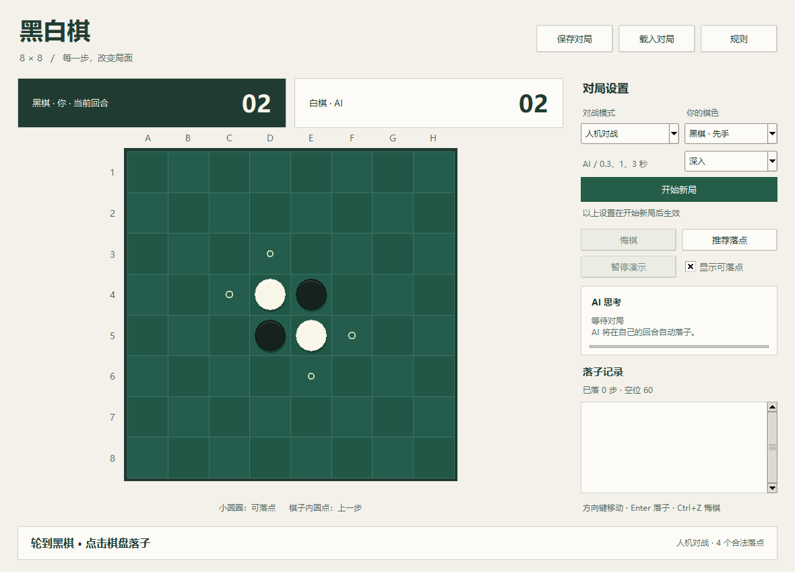

# 黑白棋 · 8×8 Python 桌面版

从旧版 `Black and White Chess` C/C++ 实验项目迁移而来，统一为 **8×8 棋盘**。支持鼠标点击落子，使用 Python 标准库，无需安装第三方依赖。



## 启动

当前分支为 **`feature/8x8-board`**，提供标准 8×8 棋盘（A1–H8，64 格）；[main 分支](https://github.com/KishinamiHakuno0111/blackVSwhite/tree/main) 保留 10×10 版本。两个版本的存档不互通，错误尺寸的存档会被明确拒绝。

**Windows 可执行文件：** 在本分支运行 `tools/build_windows.ps1`，生成 `dist/BlackWhiteChess-8x8.exe` 和相应压缩包，双击 exe 无需 Python。现有 `v1.0.0` Release 是 10×10 版，不能作为本分支的 8×8 下载文件。构建与分发见 [DISTRIBUTION.md](DISTRIBUTION.md)。

**从源码运行：**

Windows 下双击 **`start_game.bat`**，或者在本目录运行：

```powershell
python main.py
```

也可以使用 `python -m reversi`。需要 Python 3.10 或以上，并带有 Tkinter（Windows 官方 Python 安装程序默认提供）。本机已验证 Python 3.14 / Tk 9.0，系统为 Windows。

## 怎么玩

1. 默认是人机对战，你执黑先行，AI 使用“深入”模式，每步最多约 3 秒搜索。
2. 点击带小圆圈的格子落子；黑白棋子的内圆点标记上一步。鼠标移到格子上，可查看能翻多少子。
3. 可以选择“人机对战 / 双人对战 / AI 演示”，以及执黑或执白；点击“开始新局”应用设置。
4. 无合法落点时自动跳过。双方都无法落子时结束，即使棋盘未满；按实际黑白棋子数判胜或平局。

| 操作 | 行为 |
|---|---|
| 悔棋 | 人机模式撤回到你上次落子前；双人/演示撤回一步，演示同时暂停 |
| 推荐落点 | 使用当前 AI 档位分析，以金色圆圈标出建议，不自动落子 |
| 暂停演示 | 立即取消当前 AI 计算；可以继续演示 |
| 保存 / 载入 | JSON 棋谱和对局设置；载入时逐步复核合法性；演示存档载入后保持暂停 |
| 显示可落点 | 开关合法落点圆圈，悬停仍显示落点信息 |

快捷键：方向键定位、Enter/空格落子，Ctrl+N 新局、Ctrl+Z 悔棋、Ctrl+S 保存、Ctrl+O 载入、F1 规则。可以用 Tab 将焦点移动到棋盘和其他控件。

棋盘自适应窗口，建议使用 1180×850 或更大窗口，最小窗口为 1000×780。界面使用原生 Tk 控件和自绘棋盘，支持鼠标和键盘；未声称通过屏幕阅读器无障碍认证。

## AI 做了什么

整合旧版 `superAI`、`superAI2.0` 及其他实验中有用的思路，重新实现搜索和规则：

- **迭代加深 + Negamax / Alpha-Beta**，保留最后一轮完整搜索的落点；限时未完成时也保证返回合法候选。
- **置换表、最佳落点排序、历史排序**，减少重复搜索。角位优先参与排序和评价，但不跳过搜索而强制抢角。
- **阶段性局面评价**（按 64 格比例划分阶段）：位置权重、实际行动力、潜在行动力、角位、稳定子、前沿子、子数及残局空区奇偶性。
- **稳定子**按所属棋手分别计算，从已占角位向外保守推导；不会采用“周围有子就是稳定子”的旧判断。
- **空区奇偶性**按四邻接连通区域计算，在残局用于评价与搜索排序。它是启发式，最终胜负仍由实际终局子数决定。
- **残局求解**：进入阈值后尝试搜索到终局；允许跳过回合，跳过不消耗落子深度；只有搜索完成才标为“终局已解”。
- **随机整局模拟**：均衡/深入模式使用少量模拟辅助根节点排序，最多占约 8% 搜索预算；最终决策仍由搜索评分决定。
- **独立进程**计算 AI，界面保持响应；新局、悔棋、载入、暂停和关闭会取消旧计算。

| 档位 | 每步搜索预算 | 常规深度上限 | 尝试精确求解的空位数 |
|---|---:|---:|---:|
| 快速 | 0.3 秒 | 5 | ≤8 |
| 均衡 | 1 秒 | 8 | ≤10 |
| 深入 | 3 秒 | 12 | ≤12 |

搜索预算不包括进程启动和界面刷新，时间检查也有少量调度余量。深度是实际落子数；达到深度上限会提前返回，复杂局面可能因时间用尽而只完成较浅搜索。面板评分以注明的棋色为准，**不是胜率**。这是一套可验证、比原贪心基线更强的综合实现，不是对任意局面全局最优或竞赛最强的保证。

## 文件结构

```text
main.py                   桌面程序入口
start_game.bat            Windows 双击启动
reversi/
  engine.py               8×8 规则、不可变局面、跳过回合、历史与存档
  ai.py                   搜索、评价、稳定子、奇偶性、模拟、贪心基线
  worker.py               AI 子进程与取消
  ui.py                   Tkinter 棋盘和对局交互
  benchmark.py            换色、配对开局的完整对战评估
tests/                    独立数组规则、穷举残局、桌面交互和子进程测试
tools/ui_preview.py       本应用窗口截图检查（仅 Windows）
MIGRATION_NOTES.md        旧版缺陷与新实现的对应关系、验证记录
PROJECT_STATUS.md         迁移前的 C/C++ 项目审计报告
audit_*.py                旧项目检查脚本，不属于游戏运行依赖
```

旧 C/C++ 项目没有随本仓库发布，本项目运行时不读取或依赖它。

当前 8×8 版的适配和验证见 [8×8 分支说明](docs/EIGHT_BY_EIGHT.md)。`PROJECT_STATUS.md` 是旧 C/C++ 历史审计报告；`MIGRATION_NOTES.md` 保留 10×10 初版的修复记录。`audit_*.py` 仅供复查旧项目，运行前需要自行提供原始源码并设置 `BLACK_WHITE_LEGACY_ROOT` 环境变量；还需要报告所述的 MSVC 工具链。审计原始产物仅保留在作者本地，不属于仓库内容。

## 验证与对战评估

运行全部测试（界面测试会短暂创建本程序窗口）：

```powershell
python -m unittest discover -v
```

只测试不需要桌面环境的核心部分：

```powershell
python -m unittest tests.test_engine tests.test_ai -v
```

使用相同开局、黑白换色比较综合 AI 与旧版“当步翻子最多”基线：

```powershell
python -m reversi.benchmark --games 6 --seconds 0.08 --output artifacts/benchmark.json
```

8×8 分支验证：**36 项测试通过**。30 局随机对局逐步对照独立数组规则，5 个六空位残局对照独立穷举，另含强制跳过、稳定子、保存载入、鼠标/键盘落子、实际 AI 回应、撤回与取消等测试。配对开局、换色的对抗评估结果见 `docs/validation/benchmark-8x8.json`；样本较小，限时搜索结果也可能随机器性能有所变化。

截图和本机评估原始结果保存在 `artifacts/`。复现界面截图：

```powershell
python tools/ui_preview.py
```

## 开源许可证

本项目采用 [MIT License](LICENSE)。打包程序使用的 Python、Tcl/Tk、PyInstaller 等组件保留各自的许可证，相关文本包含在分发包中。
